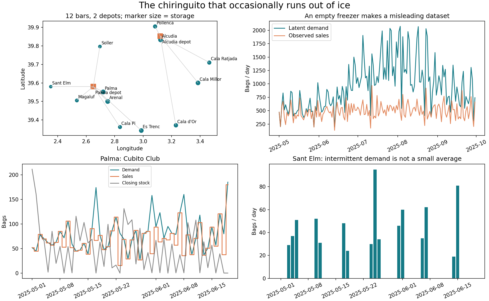

# The chiringuito that never runs out of ice

Implementation in progress. The first checkpoint is the seeded demand generator and daily simulator.

Python 3.11. Install with `python -m pip install -e '.[dev]'`, then `make simulate`.
The simulator keeps latent demand in `artifacts/truth.csv` and censored observations in
`artifacts/observed.csv`. Forecast code will only receive observations.
