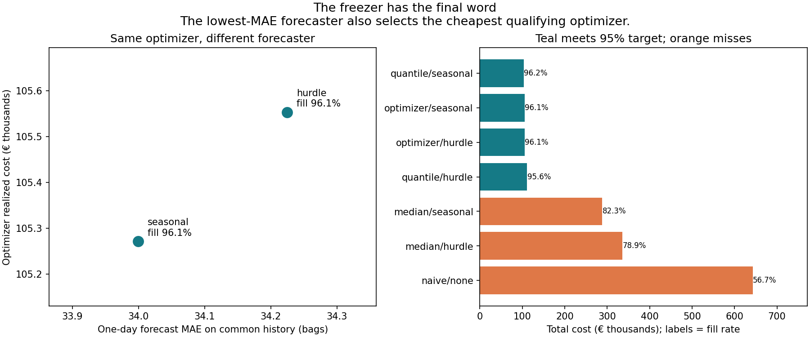
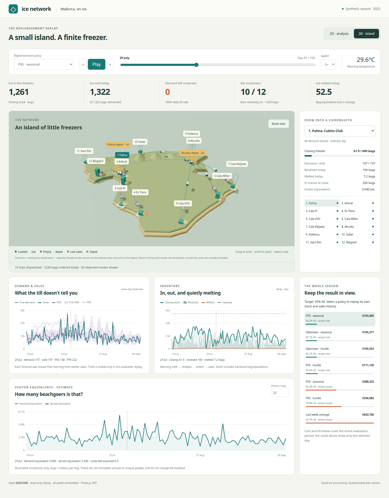
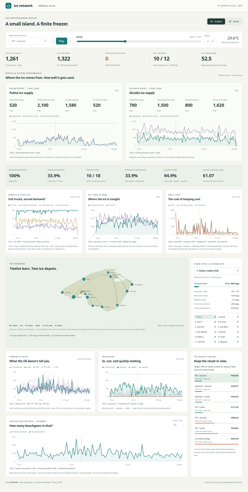
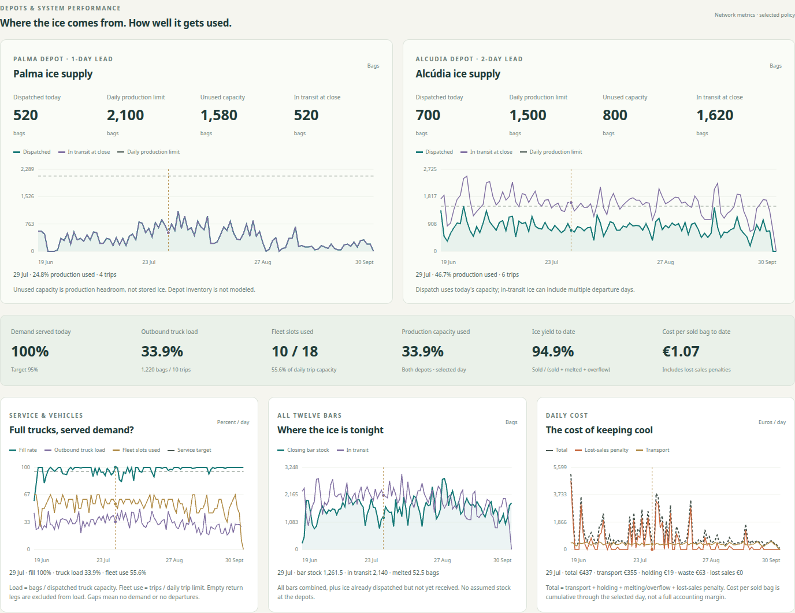

# The chiringuito that never runs out of ice



Twelve fictional beach bars in Mallorca need ice; two depots and six trucks supply it.<br>
Heat, weekends and surprise parties drive demand, while stored ice melts.<br>
Selling out hides demand: an empty freezer records no sales, even when people still want drinks.<br>
This project reconstructs that missing demand, forecasts uncertainty and plans constrained deliveries.<br>
It replays the same summer under different ordering rules to measure cost, service and waste.

**The result:** the simple seasonal P95 ordering rule costs **€103,405** and serves
**96.2% of demand**, beating the optimizer in this fixed-seed experiment. The hoped-for
case where the most accurate forecaster produces worse decisions **did not occur**.
The project reports that honestly, alongside the limits of the experiment.

## See the island in action

**[Open the interactive 2D / 3D replay](https://pinyacolada.github.io/ice-network/)**



Choose a policy, select a bar and scrub or play through the season. All charts follow
the selected day. No installation or login is needed to explore the published replay.

- **3D island:** ice columns at each bar, capacity outlines and animated deliveries.
  Teal trucks travel out with ice; purple trucks return empty to their depot.
- **2D analysis:** compare forecasts with demand and sales, and follow deliveries,
  closing stock, melting, depot dispatches and ice in transit.
- **Customers:** count bars receiving deliveries, plus clearly labeled visitor
  equivalents estimated from bags. These are illustrative estimates, not people tracked.

<details>
<summary>Open the 2D analysis screenshot</summary>



</details>



Efficiency charts show service, truck loading, fleet use, production use, ice yield
and cost per sold bag. Palma and Alcúdia have daily production limits; the simulator
does **not** model stored depot inventory. Unused production capacity is labeled accordingly.
Routes and return animations illustrate saved shipments; they are not GPS or road traces.

The replay also works offline: download [docs/index.html](docs/index.html) using
GitHub's **Download raw file** button and open it in a browser.

## How it works

1. **Simulate a summer.** Seeded weather, tourism, weekdays and random events create
   demand, including three bars with intermittent sales. Keep the true demand for
   evaluation, but give the forecasting models only censored sales and observable stockouts.
2. **Reconstruct and forecast.** Estimate missing demand from earlier similar days.
   Compare a seasonal baseline with a gradient-boosted hurdle model, which explicitly
   handles zero-demand days. Both predict P10, P50, P90 and P95 demand quantiles.
3. **Choose deliveries.** Compare last-week averages, median forecasts, a service-target
   quantile and a SCIP mixed-integer optimizer. Every policy obeys storage, case-pack,
   minimum-order, production, truck, cut-off and lead-time constraints.
4. **Replay decisions.** Retrain weekly on each policy's own observed history and
   replay the same demand day by day. Count stockouts, melting, trips and total cost.

The challenge is balancing an empty freezer against an expensive puddle. Forecast
accuracy is measured separately from the quality of the resulting decisions.

## What happened in the published run?

Seed **20261008**, May–September 2025: 49 warmup days and 104 evaluated days.
The target is **95% fill rate**, defined as bags sold divided by bags demanded.

| Policy / forecaster | Total cost | Fill rate | Lost bags | Melted bags | Trips |
|---|---:|---:|---:|---:|---:|
| Last-week average | €642,706 | 56.7% | 51,163 | 627 | 762 |
| P50 / seasonal | €288,232 | 82.3% | 20,941 | 1,181 | 956 |
| P95 / seasonal | **€103,405** | **96.2%** | 4,532 | 6,376 | 1,022 |
| Optimizer / seasonal | €105,271 | 96.1% | 4,646 | 7,131 | 1,025 |
| P50 / hurdle | €336,082 | 78.9% | 24,923 | 1,026 | 968 |
| P95 / hurdle | €111,130 | 95.6% | 5,237 | 6,272 | 1,060 |
| Optimizer / hurdle | €105,553 | 96.1% | 4,660 | 7,301 | 1,034 |

Cost includes transport, holding, melting and a lost-sales penalty; it is not full
business accounting. Service is measured across all bags, not guaranteed for each
bar or day. Low melting in the naive policy mostly means there was too little ice.

The seasonal forecaster has slightly lower one-day MAE (34.00 versus 34.22 bags)
and slightly lower optimizer cost. That €282 difference is small, especially with
a 1% solver gap tolerance. No seed search was used to manufacture a ranking.
The optimizer plans only today's orders over four days with nine demand scenarios;
its approximations help explain why it need not beat a simple rule in replay.
See the [methodology and result audit](docs/METHODOLOGY.md) for calibration,
reconstruction limitations and the full accounting assumptions.

## Run it

With Docker and Compose:

```sh
docker compose run --build --rm ice-network
```

Or with Python 3.11 and Make:

```sh
make setup
make run
make test lint
```

Open **`artifacts/replay.html`** in a browser. The run also writes plots, policy
results, forecast scores, daily ledgers and solver diagnostics to `artifacts/`.
Allow a few minutes. No API keys, external datasets or commercial solver license
are needed. The first install needs internet access; the replay does not.

The Docker image and Python dependencies are pinned. Docker uses Linux amd64,
tested locally; ARM machines use Docker's emulation.

```sh
make simulate   # Only generate demand, observations and simulator plots
make visualize  # Rebuild the replay from an existing completed backtest
make demo       # Also refresh the committed docs/index.html snapshot

# Try a different seed and service target without replacing published results:
.venv/bin/ice-network run --seed 42 --service 0.90 --output artifacts/alternative
```

## Read the code

| Module under `src/ice_network/` | Responsibility |
|---|---|
| `world.py`, `demand.py` | Mallorca locations, constraints and seeded demand |
| `simulator.py` | Inventory, melting, pipeline, censoring and ice conservation |
| `forecast.py` | Past-only reconstruction and probabilistic forecasts |
| `optimize.py`, `policies.py` | Scenario MILP and simpler ordering rules |
| `backtest.py` | Rolling replay and separate forecast/decision evaluation |
| `plots.py`, `cli.py` | Figures and command-line entry points |
| `visualize.py`, `web/` | Offline replay, 2D charts and Three.js scene |

Sixteen Python tests cover censoring, conservation, forecast leakage, MILP feasibility,
timing and replay accounting. Ruff checks formatting and lint. Optional browser
checks cover controls, offline use, mobile layouts and 2D fallback; instructions
are in the [validation notes](docs/METHODOLOGY.md#backtest-and-findings).

## What I would do next in production

Start with real sales, availability and stockout timestamps, issued weather forecasts
and road travel times. Model uncertain lead times and demand shared across bars,
then add multi-echelon depot inventory and future replenishment decisions. Give
operators overrides, exception handling for late trucks or broken freezers, and
audit logs. Test multiple seasons and cost assumptions before trusting small rankings.
